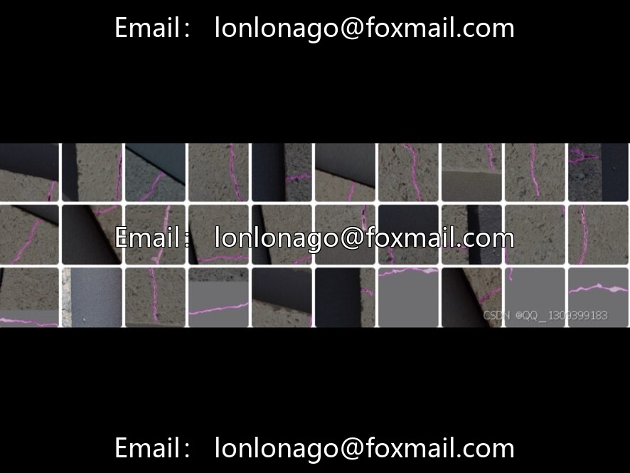
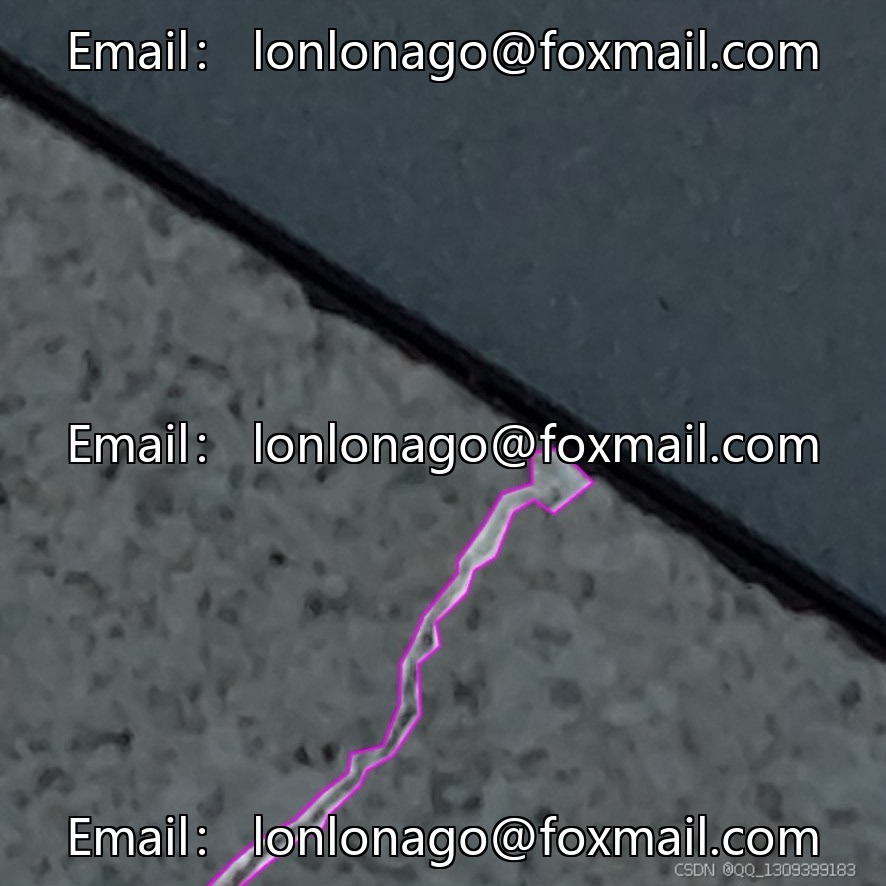
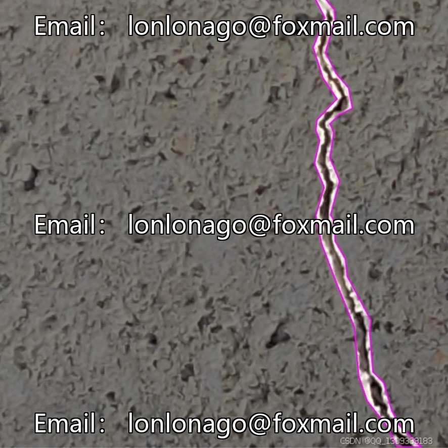
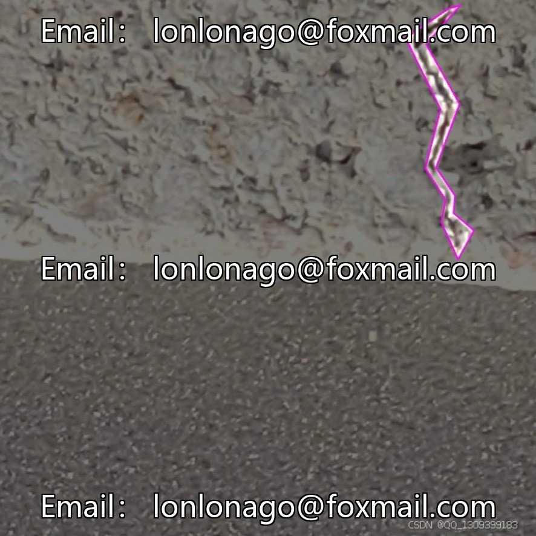
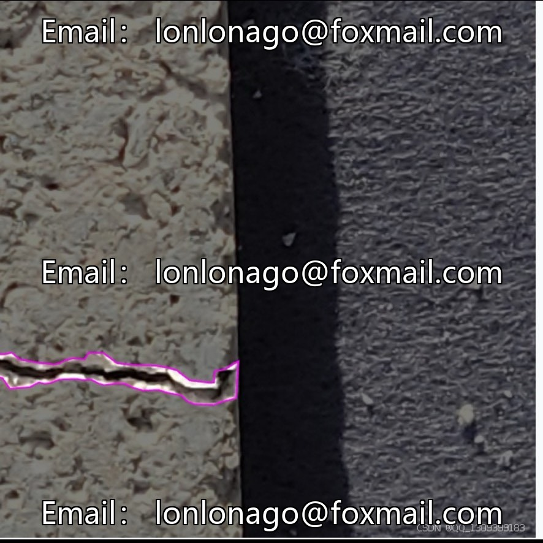
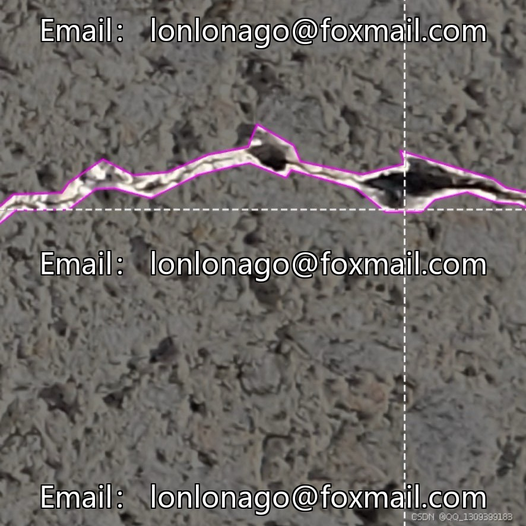

# Bridge crack segmentation dataset

## Body

Bridge crack dataset example segmentation dataset for intelligent bridge crack detection dataset (target detection/example segmentation), issue 10094

Containing 2181 images of bridge surface cracks, focusing on the "crack" category, suitable for scenarios such as bridge inspection, construction testing, drone inspection, etc. The dataset covers various parts of the beam body, abutment columns, and other areas, with clear annotations and good model training effects.

Task Type: Instance segmentation/Object detection
Total Images: 2181
Number of Categories: 1 (Crack)
Scene Coverage: Bridge beams, piers, sunny and cloudy days, fine and wide cracks

Virtual materials, once sold, are non-refundable.
Interested friends, click "I want" to proceed.

## Images

## Payment

Here is a pay link on Stripe ( https://buy.stripe.com/3cs8yP7sY87d0vu9AB ). Please contact me lonlonago@foxmail.com after funding $89, and I will send you a complete data files , thank you!

